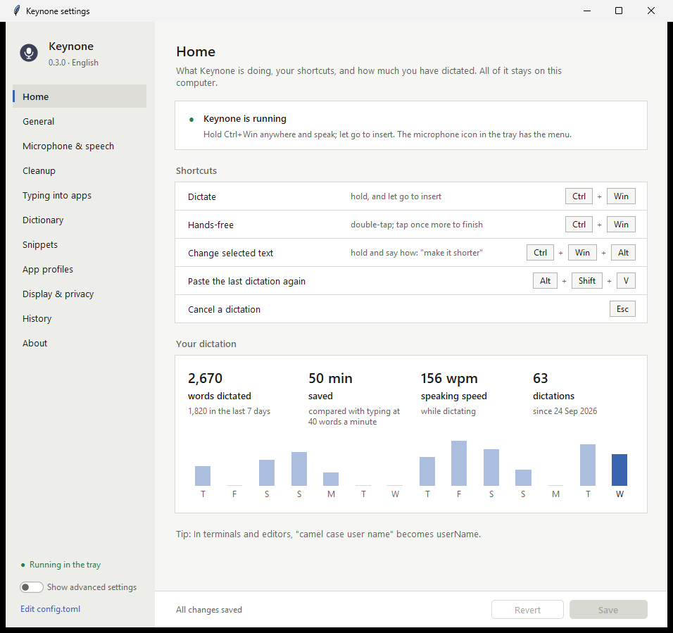

# Keynone

**Local, private voice dictation for Windows — speak naturally, get clean text in any app.**

Hold **Ctrl+Win**, talk, let go: Keynone removes filler words and repetitions,
applies your self-corrections ("…at three, no wait, four PM" → "…at 4 PM"),
formats lists and punctuation, and types the result wherever your cursor is.
Everything runs on your CPU with open models; nothing leaves your computer.

Built and measured on an AMD Ryzen 5 5600H with 16 GB RAM:
live text **≤ 0.81 s** behind your voice, polished text **0.15–0.8 s** after you
release the key, **0 % CPU** while idle.

## Features

| | |
|---|---|
| Works in any app | Paste (clipboard restored, kept out of clipboard history) or Unicode typing per app |
| Removes filler words | um, uh, er, hmm… instantly; "you know" / "like" between commas too; other soft fillers via the local LLM |
| Removes repetition | "I I think", "we need to, we need to talk", "I want to go to the, I want to go to the store" |
| Auto-edits when you change your mind | "at three, no wait, four", "Monday no Tuesday", "…by six. Sorry, I meant seven", "no, scratch that, six thirty" — while "no rush" or "I'm sorry" stay as said |
| Auto-formats | Numbered/bulleted lists ("first… second…", "number one…", "one… two… three…", "we need three things: a, b and c"), sentence punctuation and question marks, times ("4:30 PM") |
| Live preview | Overlay with level meter and the latest text; never steals focus |
| Hands-free | Double-tap the hotkey; tap again to finish; Esc cancels |
| Voice commands | "new line", "new paragraph" (also mid-sentence), "scratch that" (removes what you said since your last pause) |
| Spoken punctuation | "comma", "period", "question mark", "colon", "open bracket"…, and addresses: "jane dot doe at example dot com" → jane.doe@example.com, "main dot py" → main.py. The words stay words where they belong ("the Oxford comma", "a period of time"); "literal comma" types the word |
| Quiet microphones | Speech too quiet for the recognizer is lifted automatically (normal levels are left alone) |
| App-aware | Chat apps (no trailing period), e-mail, and a prompt style for AI assistants in terminals, code editors and AI apps (Claude Code, Cursor, ChatGPT…): sentences as prose, commands as you said them ("git status"), "camel case user name" → userName, "at main dot py" → @main.py |
| Personal dictionary | Your spellings for names and jargon. **Learns from your corrections:** fix a name right after dictating it ("Amid" → "Aamir") and Keynone writes it your way from then on |
| Snippets | Say "my address" (or "insert my address" mid-sentence) and your saved text goes in exactly as written: addresses, signatures, meeting links |
| History | Local SQLite: search, copy or delete past dictations in the settings window; **Alt+Shift+V** pastes the last one again (when it went into the wrong window) |
| Private & contained | Offline after setup; every file lives inside this folder |
| **Speak-to-edit** | Select text anywhere, hold **Ctrl+Win+Alt**, say "make it shorter" / "more formal" / "translate to Spanish" — the selection is rewritten |
| **Smart spacing** | Reads the text around the cursor: lowercase mid-sentence, one space between words, no doubled punctuation, lists start on a new line; detects password fields in browsers too |
| **Multilingual** | 40 locales (Hindi, Spanish, French, German, Italian, Portuguese, Russian, Japanese, Korean, Chinese, Arabic …), auto-detected; optional translation of every dictation |
| **GPU boost (optional)** | The language model on your GPU (e.g. GTX 1650 via Vulkan): ~3× faster polishing, ~5× faster speak-to-edit |

## Download

There are two editions of the same app. They differ only in the models the
installer downloads, so you don't store a 651 MB speech model you never use:

| | **Keynone** | **Keynone + languages** |
|---|:---:|:---:|
| English dictation, cleanup, speak-to-edit, smart spacing, GPU option | ✓ | ✓ |
| Dictation in 40 other languages, language-aware cleanup | | ✓ |
| Translating every dictation into another language | | ✓ |
| Models downloaded during setup | ~1.4 GB | ~2.0 GB |
| Disk space after setup (models, Python, app) | ~1.5 GB | ~2.2 GB |
| Release file | `keynone-<version>-windows.zip` | `keynone-<version>-windows-languages.zip` |

Not sure? Take **Keynone**. You can add the language pack at any time with
`keynone setup --edition languages` (or from the settings window), and remove it
again. English dictation is exactly the same in both.

## Quick start

Requirements: Windows 10/11 x64, [uv](https://docs.astral.sh/uv/), 2–3 GB free disk.

Extract the zip (or clone this repository), then run this in PowerShell, inside the
`keynone` folder:

```bash
powershell -ExecutionPolicy Bypass -File .\scripts\install.ps1
```

The installer downloads the models of your edition and nothing else: no developer
tools, and it clears its download cache when it's done. From a git clone, add
`-Edition languages` to get the language pack too. To update later, extract a newer
zip over the old folder and run the installer again: your settings, history and
models stay.

Then double-click **`Keynone.cmd`**. A microphone icon appears in the tray.

* **Hold Ctrl+Win** and speak → release to insert.
* **Double-tap Ctrl+Win** → hands-free; tap again to finish.
* **Alt+Shift+V** → paste the last dictation again.
* **Select text, hold Ctrl+Win+Alt** and say how to change it → release; the
  selection is replaced (Ctrl+Z undoes it in most apps).
* **Esc** → cancel.
* Settings: tray icon → *Settings...*, or `Keynone-settings.cmd`.
* Stop: tray icon → *Quit Keynone*, or `Keynone-stop.cmd`.

The first dictation after Keynone has been idle takes ~5 s before live text
appears (the speech model loads; your audio is already being recorded).

## How it stays out of the way

Only a tiny listener stays running (≈22 MB, 0 % CPU, no microphone, no models).
The engine (≈2 GB) starts when you press the hotkey and unloads after
`lifecycle.keep_warm_seconds` (default 300 s). Set it to `0` for strict
on-demand: nothing heavy stays resident, at the cost of the ~5 s model load on
every dictation.

## Settings

**The settings window:** tray icon → *Settings...*, double-click
`Keynone-settings.cmd`, or run `keynone settings`. It opens on a Home page (is
Keynone running, your shortcuts, how many words you've dictated and the time that
saved), has every option in plain words, with the rarely needed ones behind
*Show advanced settings*, and a History page. It follows the Windows light/dark
mode.



**Or the file:** all settings live in `data/config.toml` (created on first run;
tray → *Edit config.toml*). The window edits that same file in place, so your
comments and notes in it survive. Either way, a running Keynone applies saved
changes within a second, never in the middle of a dictation.

```toml
[hotkeys]
dictate = "ctrl+win"        # e.g. "rctrl", "capslock", "ctrl+alt+space", "f9"

[lifecycle]
keep_warm_seconds = 300     # 0 = strict on-demand

[cleanup]
llm_mode = "auto"           # "always" for maximum polish, "off" for rules only

[dictionary]
words = ["Keynone", "PostgreSQL"]
[dictionary.replacements]
"chat gpt" = "ChatGPT"
```

Maximum polish (slower, Apache-2.0 model):
`keynone setup --with qwen3.5-2b-q4km`, then set `llm.model = "qwen3.5-2b-q4km"`
and `cleanup.llm_mode = "always"`.

### Other languages

These need the language pack (the *Keynone + languages* download, or add it):

```bash
keynone setup --edition languages
```

```toml
[asr]
language = "auto"         # or a fixed language: "hi", "es", "de", "fr", "ja" ...

[cleanup]
translate_to = ""         # e.g. "English": every dictation is written in English
```

English keeps the more accurate English-only model (`language = "en"`). For
other languages the same instant rules apply where they are safe (fillers such
as "äh", "euh"; repetitions), and the LLM steps in only for sentences with a
self-correction or filler cue. Translation quality is best with Qwen3.5 2B.
Without the language pack these settings fall back to English (Keynone tells you
in the tray) instead of failing.

### GPU acceleration

```bash
keynone setup --with llama.cpp-b11398-vulkan-x64
```

```toml
[llm]
gpu = "auto"              # picks the discrete GPU (e.g. NVIDIA GTX 1650); "off" = CPU
```

Speech recognition stays on the CPU (it is already ~3× faster than real time);
the GPU accelerates the language model. If the GPU can't be used, Keynone falls
back to the CPU automatically. `keynone doctor` lists the GPUs it can see.

## Command line

```bash
.venv\Scripts\keynone.exe --help
```

| Command | Purpose |
|---|---|
| `keynone setup [--edition base\|languages] [--list] [--with ID] [--remove ID]` | Download/verify models (default: the edition of your download) |
| `keynone listen [--dry-run]` | Run the listener (`--dry-run`: show, never type) |
| `keynone stop` | Stop the listener |
| `keynone settings` | Open the settings window (it edits `data/config.toml`) |
| `keynone doctor` | Check installation, models, microphone |
| `keynone devices` | List microphones |
| `keynone history [-n 20]` | Recent dictations |
| `keynone transcribe a.wav [b.wav…] [--realtime] [--language auto] [--translate-to English] [--gpu auto]` | Run WAV files (any PCM format) through the full pipeline |
| `keynone bench cleanup [--gpu auto]` / `keynone bench asr [--language auto]` | Quality and speed benchmarks |
| `keynone autostart enable\|disable\|status` | Start at Windows sign-in (creates a Startup shortcut — the only file written outside this folder) |

## Privacy

No network after setup, no telemetry. The local LLM server listens only on
127.0.0.1 with a random key. Transcripts are kept only in `data/history.db`
(disable with `[history] enabled = false`) and never written to logs unless
`privacy.log_transcripts = true`. Password fields are skipped (detected via UI
Automation, which reads only the few characters around the cursor, only at the
moment of inserting, and never stores them).

## Development

From a git clone (the release zips leave the developer files out):

```bash
powershell -ExecutionPolicy Bypass -File .\scripts\install.ps1 -Dev   # + pytest, ruff, mypy
. .\scripts\env.ps1                     # keeps uv caches/temp inside the folder
uv run pytest                           # unit + integration tests (incl. the stress set)
uv run ruff check src tests scripts && uv run mypy
uv run python scripts/make_test_audio.py   # synthesized test dictations
uv run keynone transcribe --realtime data/test_audio/*.wav
uv run python scripts/build_release.py --working-tree   # both release zips, into dist/
```

See [CONTRIBUTING.md](CONTRIBUTING.md) before opening a pull request.

Stress test (adversarial dictations, `src/keynone/evaldata/dictation_stress*.jsonl`):

```bash
uv run python scripts/stress_test.py text [--llm]   # four recognizer styles, rules (+ LLM)
uv run python scripts/stress_test.py synth          # speak the cases with the Windows voices
uv run python scripts/stress_test.py asr            # record what the speech model hears
uv run python scripts/stress_test.py audio [--llm]  # replay it through the cleanup
uv run python scripts/stress_test.py edit           # speak-to-edit instructions + rewrites
```

Desktop tests (type into their own window, open the mic for ~2 s, start the LLM):
`$env:KEYNONE_DESKTOP_TESTS="1"; uv run pytest tests/test_desktop_*.py`

Docs: [feasibility & model selection](docs/01-feasibility-and-model-selection.md) ·
[specification](docs/02-specification.md) ·
[implementation plan & roadmap](docs/03-implementation-plan.md)

```
src/keynone/
  listener/   hotkey state machine, engine process manager, tray app
  settings/   settings window (Tk): option list, config.toml editing, theme, controls
  engine/     session, overlay, insertion, history, model loading
  cleanup/    rules, correction resolver, segmenter, pipeline, LLM, guard, prompts
  cleanup/language.py  per-sentence language detection
  win32/      ctypes Win32 layer (hook, waveIn, clipboard, SendInput, windows, tray)
  win32/uia.py  UI Automation client (text around the cursor, selection, password fields)
  asr.py      streaming speech recognition (sherpa-onnx; English or multilingual)
  assets.py   pinned model registry + verified downloader
```

## Models and licenses

| Component | License |
|---|---|
| NVIDIA Nemotron Speech Streaming EN 0.6B (speech) | NVIDIA Open Model License |
| NVIDIA Nemotron 3.5 ASR Streaming 0.6B (language pack, multilingual speech) | OpenMDW-1.1 |
| Liquid LFM2.5 1.2B Instruct (cleanup) | LFM Open License v1.0 (free for individuals and organizations under $10M revenue) |
| Qwen3.5 2B (optional) | Apache-2.0 |
| sherpa-onnx / ONNX Runtime | Apache-2.0 / MIT |
| llama.cpp (CPU and optional Vulkan build) | MIT |
| comtypes (UI Automation) | MIT |

The models are not part of Keynone's code and are not inside the downloads: setup
fetches them from their publishers and checks every file against a pinned SHA-256
digest.

## License and contributing

Keynone is free software under the [MIT License](LICENSE). Contributions are
welcome. See [CONTRIBUTING.md](CONTRIBUTING.md) for the setup, the checks to run
and the rules for cleanup changes, and [SECURITY.md](SECURITY.md) to report a
security problem. Changes are listed in [CHANGELOG.md](CHANGELOG.md).

Keynone is an independent project and is not affiliated with Typeless.
